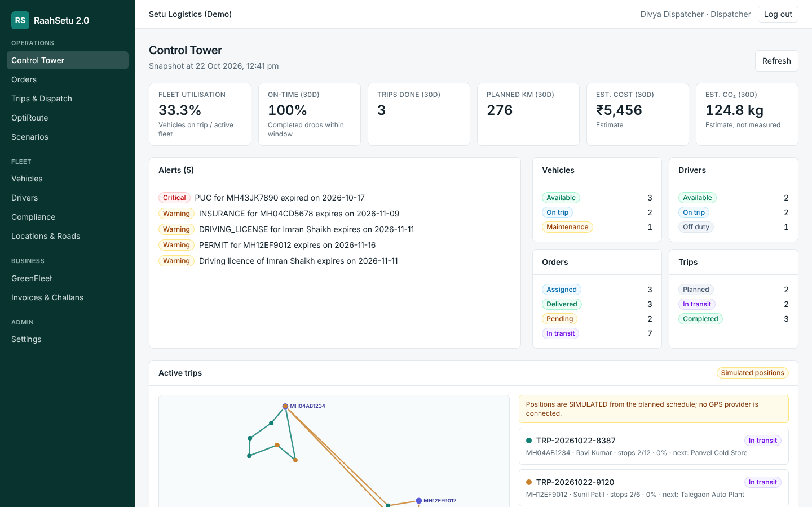
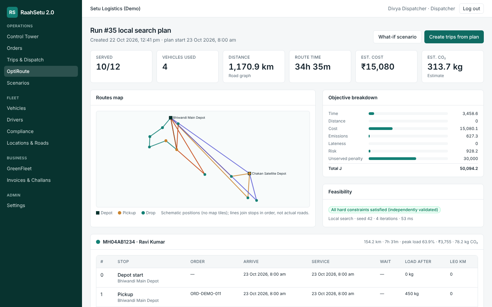
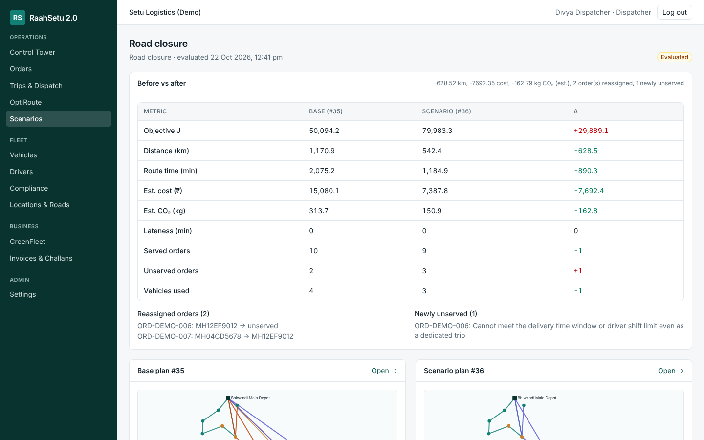
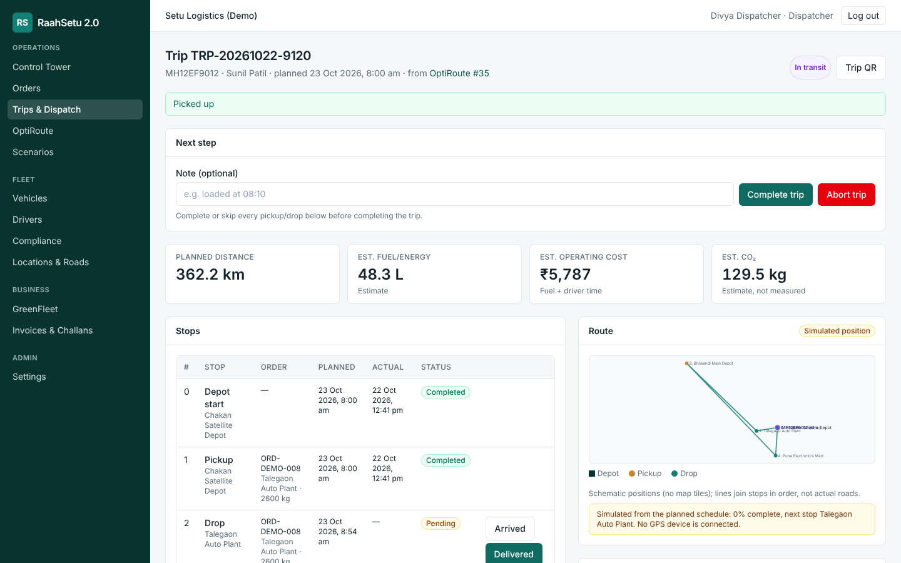
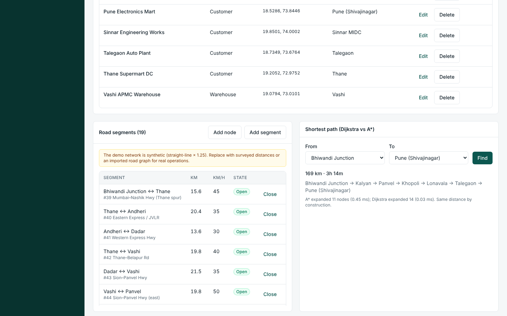
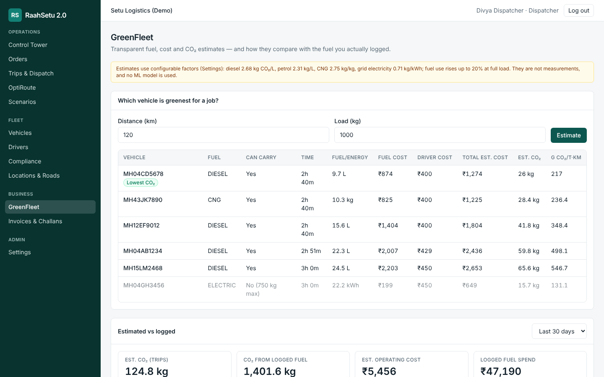
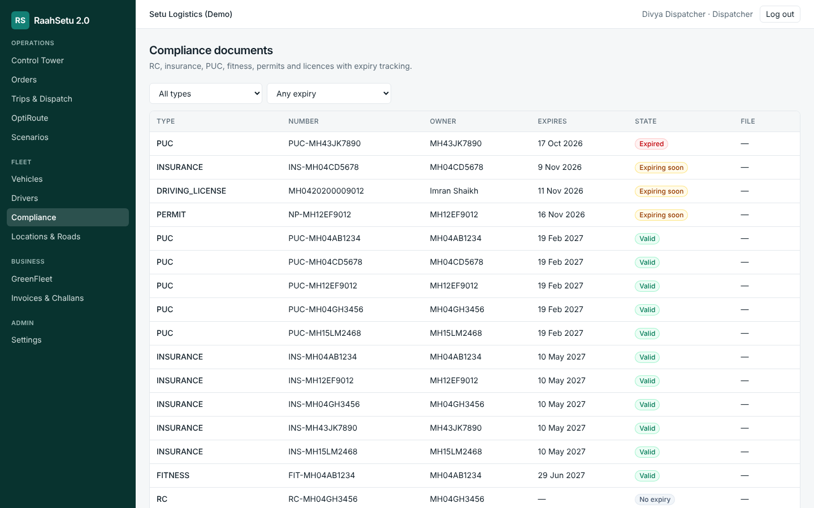
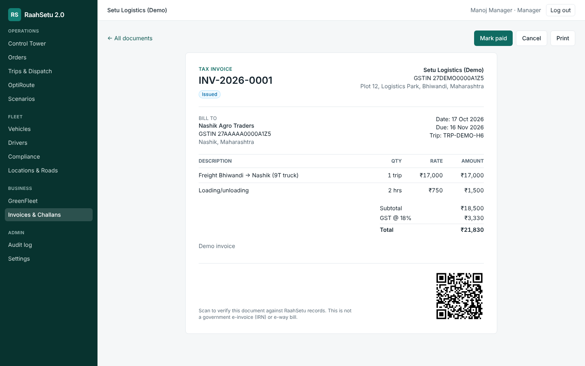
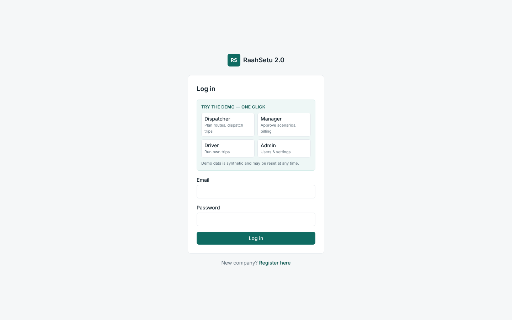
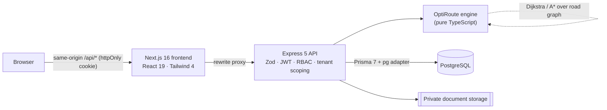

<div align="center">

# RaahSetu 2.0

**Fleet operations & dispatch platform with constrained route optimisation**

Plan which truck serves which orders without breaking capacity, delivery-window or driver-shift limits — then dispatch, track, bill and verify, with transparent fuel and CO₂ estimates.


**[Live demo](https://<your-app>.vercel.app)** · one-click demo logins · [Setup](docs/SETUP.md) · [API](docs/API.md) · [OptiRoute](docs/OPTIROUTE.md) · [Deploy](docs/DEPLOYMENT.md)



</div>

---

## Why this project

Small and mid-size Indian transport operators juggle vehicles, drivers, RC/insurance/PUC expiries, orders and trips across spreadsheets and phone calls, and plan routes by gut feel or shortest distance. RaahSetu puts the whole operation in one multi-tenant web app and adds an optimiser that answers the dispatcher's real question — *which vehicle should take which orders, in what sequence, today?* — while explaining every trade-off it makes.

## Features

| | |
|---|---|
| **OptiRoute** — multi-vehicle pickup-and-delivery routing with capacity, precedence, time windows, shift limits, vehicle/driver eligibility and closed roads. Three algorithms, an independent plan validator, a reason for every unserved order and a per-term objective breakdown. |  |
| **What-if scenarios** — breakdown, driver absence, road closure or urgent order → re-optimise → before/after comparison → manager approval applies the change. |  |
| **Trips & dispatch** — state machine (planned → dispatched → in transit → completed), stop-level progress by drivers, full timeline, simulated live position. |  |
| **Road network** — editable graph with one-way/closed roads; Dijkstra vs A* comparison. |  |
| **GreenFleet** — fuel, cost and CO₂ estimate per vehicle for any job, estimated vs logged fuel, observed mileage — every assumption visible and editable. |  |
| **Compliance** — RC, insurance, PUC, fitness, permit, licence expiry tracking with alerts; expired documents automatically block planning and dispatch; private, signature-checked uploads. |  |
| **Invoices, challans & QR** — GST invoices and delivery challans with a public QR verification page. |  |
| **Multi-tenant SaaS basics** — company sign-up, five roles (admin, manager, dispatcher, read-only, driver), audit log, one-click demo logins. |  |

## Architecture



- **Frontend** never talks to the API cross-origin: Next.js rewrites `/api/*` to Express, so the session cookie is first-party and CORS stays closed.
- **API** is organised by module (`auth`, `vehicles`, `trips`, `optiroute`, `scenarios`, `billing`, …), each with Zod-validated input and permission checks.
- **OptiRoute** has no database access: `solve(instance) → solution`. It can be unit-tested, benchmarked and swapped for another engine behind the same contract.

## Engineering highlights

- **Constraint-safe optimisation.** Greedy cheapest-insertion baseline → best-improvement local search (relocate + exchange) → seeded simulated annealing. An *independent* validator re-simulates every route; a plan is only marked feasible if it reports zero violations. Benchmarks are reproducible (fixed seeds, recorded hardware) — see [docs/OPTIROUTE.md](docs/OPTIROUTE.md). On a synthetic 50-order / 8-vehicle instance, annealing served 50/50 orders against 45/50 for the greedy baseline.
- **Tenant isolation by construction.** The company scope always comes from the authenticated user in the database, never from request input; cross-company reads, updates, deletes and file downloads return 404 — covered by integration tests.
- **Transactional workflows.** Dispatch, trip transitions, stop updates and scenario approval run in database transactions with explicit state-machine checks.
- **Security basics done properly.** bcrypt, httpOnly SameSite cookies, rate-limited auth and public endpoints, Helmet, upload allow-list with file-signature checks, no static file serving, audit log without secrets.
- **Honest data.** Estimates, simulated GPS positions and synthetic demo data are labelled as such everywhere in the UI.

## Tech stack

| Layer | Technology |
|---|---|
| Frontend | Next.js 16 (App Router), React 19, TypeScript, Tailwind CSS 4 |
| Backend | Node.js 22, Express 5, TypeScript, Zod 4, JSON Web Tokens, Multer, QRCode |
| Database | PostgreSQL 16, Prisma 7 (driver adapter `@prisma/adapter-pg`), SQL migrations |
| Testing | Vitest, Supertest, real-PostgreSQL integration tests, Playwright (end-to-end run) |
| Tooling | ESLint (typescript-eslint, eslint-config-next), esbuild, GitHub Actions CI, Docker Compose |

## Quick start

**Option A — Docker** (needs Docker Desktop):
```bash
cp .env.example .env          # then set POSTGRES_PASSWORD and JWT_SECRET
docker compose up --build     # → http://localhost:3000, click "Dispatcher"
```

**Option B — Node + PostgreSQL** (full Windows/PowerShell walkthrough in [docs/SETUP.md](docs/SETUP.md)):
```bash
npm run setup                 # installs root, backend, frontend from lockfiles
# create backend/.env from backend/.env.example (DATABASE_URL, TEST_DATABASE_URL, JWT_SECRET)
npm run db:deploy && npm run db:seed
npm run dev                   # API :5000 + web :3000
```

Demo users (development only, password `Demo@1234`): `dispatcher@`, `manager@`, `driver@`, `viewer@`, `admin@demo.raahsetu.local`, plus `admin@other.raahsetu.local` for a second company. With `NEXT_PUBLIC_DEMO_MODE=true` the login page shows one-click buttons.

## Tests & quality

From the project root:

```powershell
npm run typecheck      # tsc --noEmit in backend and frontend
npm run lint           # ESLint (typescript-eslint / eslint-config-next)
npm test               # backend unit + integration tests, frontend unit tests
npm run build          # backend bundle (dist/server.js) + Next.js production build
npm run check          # all of the above in order
```

- Integration tests run against `TEST_DATABASE_URL`: the test setup drops its schema and applies every committed migration SQL file in order (no Prisma CLI needed). If it is not set they are **skipped** with a warning; unit tests still run.
- Backend only: `npm --prefix backend run test:unit` / `npm --prefix backend run test:integration`.
- Optimiser benchmark on synthetic instances: `npm run benchmark` (see `docs/OPTIROUTE.md`).

Production-style run after `npm run build`:

```powershell
npm start   # backend on :5000 (node dist/server.js) + frontend on :3000 (next start)
```

CI ([.github/workflows/ci.yml](.github/workflows/ci.yml)) runs install-from-lockfiles, type-check, lint, all tests against a PostgreSQL service container, both production builds and a benchmark smoke run on every push.

Current results are recorded in [docs/VERIFICATION.md](docs/VERIFICATION.md): 44 backend tests (25 unit + 19 integration on PostgreSQL), 5 frontend tests, type-check and lint clean, production builds, and a 23-step browser run.

## Project structure

```
raahsetu/
├─ package.json              # root scripts (setup, dev, check, db:*), concurrently
├─ docker-compose.yml · .env.example (compose only) · LICENSE
├─ .github/workflows/ci.yml  # type-check, lint, tests on PostgreSQL, builds
├─ docs/  SETUP.md · DEPLOYMENT.md · API.md · OPTIROUTE.md · VERIFICATION.md · screenshots/
├─ .gitignore · .gitattributes · .editorconfig · .nvmrc
├─ backend/
│  ├─ package.json · tsconfig.json · eslint.config.js · vitest.config.ts · prisma.config.ts
│  ├─ Dockerfile · .env.example
│  ├─ prisma/
│  │  ├─ schema.prisma
│  │  ├─ seed.ts                       # development-only demo data
│  │  └─ migrations/                   # 20261005105336_init (v1) + 20261019120000_raahsetu_v2
│  ├─ src/
│  │  ├─ server.ts · app.ts
│  │  ├─ config/        env.ts (validated env) · prisma.ts
│  │  ├─ middleware/    auth.ts (JWT, permissions) · error.ts
│  │  ├─ lib/           errors, validation, permissions, audit, tokens, numbering
│  │  ├─ optimizer/     pure OptiRoute engine: types, graph (Dijkstra/A*), distance,
│  │  │                 costModel (GreenFleet factors), evaluate, solver, validate, rng, synthetic
│  │  ├─ modules/       auth, users, company, vehicles, drivers, documents, locations,
│  │  │                 roadNetwork, orders, trips, optiroute, scenarios, greenfleet,
│  │  │                 fuel, billing, verify (public QR), controlTower, audit
│  │  └─ scripts/benchmark.ts
│  └─ tests/  unit/ (optimizer, graph, domain) · integration/api.test.ts · globalSetup.ts
└─ frontend/
   ├─ package.json · next.config.ts (proxies /api → backend) · tsconfig.json · eslint.config.mjs
   ├─ Dockerfile · vitest.config.mts · .env.example
   └─ src/
      ├─ app/
      │  ├─ page.tsx (landing) · login/ · register/ · verify/[token]/ (public QR page)
      │  └─ (app)/  dashboard · vehicles · drivers · documents · locations · orders · trips
      │             optiroute (runs/[id], compare) · scenarios · greenfleet · billing
      │             users · audit · settings
      ├─ components/  AppShell, AuthProvider, RouteMap (schematic SVG), forms, ui
      └─ lib/         api client, useApi hook, formatters, types
```

## Security notes

- **Same-origin API:** the browser only talks to Next.js; `next.config.ts` rewrites `/api/*` to Express, so the session cookie is first-party (`httpOnly`, `SameSite=Lax`, `Secure` when `COOKIE_SECURE=true`). API clients can use `Authorization: Bearer <token>` (returned by login).
- **Tenant isolation:** `companyId` always comes from the authenticated user loaded from the database. Reads/updates/deletes look records up with `{ id, companyId }`; references to other records (locations, vehicles, drivers, trips, edges) are verified to belong to the same company. Cross-company access returns 404. Covered by integration tests.
- **Validation & errors:** Zod schemas on every body/query; consistent JSON errors `{ error: { code, message, details } }`; Prisma unique/foreign-key errors mapped to 409.
- **Passwords:** bcrypt (cost 12), letter+number, ≥ 8 chars; emails normalised; login timing equalised.
- **Rate limits:** auth endpoints (configurable) and the public verification endpoint.
- **Uploads:** memory → validated (type allow-list + file signature + size) → private `UPLOAD_DIR/<companyId>/<random key>`; download only through an authenticated, tenant-checked endpoint with `nosniff`.
- **Transactions:** dispatch, trip transitions, stop updates, scenario approval, billing edits.
- **State machine:** invalid trip transitions are rejected (409); drivers can only start/complete their own trips.
- **Audit log:** significant actions with minimal metadata (never passwords, tokens or bodies).
- **Optimiser contract:** `backend/src/optimizer` is pure TypeScript with typed inputs/outputs, so a different engine (e.g. a future ApexCUDA adapter) can be swapped in behind `solve(instance)`.

## Scope

This is a complete, working product core. External services that need commercial accounts or government credentials are deliberately **not** integrated; each has a clear boundary in the code:

| Area | Status |
|---|---|
| Live GPS / telemetry | **Simulator** (`backend/src/modules/trips/telemetry.ts`) interpolates along the planned schedule; always labelled "simulated". Plug a provider in there. |
| Maps / traffic | No map tiles or traffic API (none configured). Maps are schematic SVG; distances come from your road network or a labelled straight-line × 1.3 estimate. |
| Road network data | Demo network is **synthetic** (straight-line × 1.25). Enter surveyed distances or import a real graph for operations. |
| Emission factors & fuel prices | Configurable defaults (diesel 2.68 kg/L, petrol 2.31 kg/L, CNG 2.75 kg/kg, grid 0.71 kg/kWh; INR placeholder prices). Verify before formal reporting. |
| ML fuel prediction | Not included — no representative data to train/validate against a baseline. |
| GST / e-invoice / e-way bill / VAHAN / FASTag | Not integrated. Invoices apply a single GST % on the subtotal; QR verification is RaahSetu-only. |
| ApexCUDA / GPU, QPSO | Not included. Simulated annealing is a classical metaheuristic; no quantum or GPU speed-ups are claimed. |
| Email / SMS / password reset | Not included (admins set initial passwords; users change them in Settings). |
| File storage | Local private directory. For cloud deployment, swap `modules/documents/storage.ts` for S3/GCS with signed URLs. |

**Roadmap:** real map tiles and road distances → email/SMS notifications and password reset → GPS/telematics adapter → GST e-invoice / e-way bill via a GSP → mobile-first driver app.

## Deploy

Free public demo with Neon (PostgreSQL) + Render (API) + Vercel (web): see [docs/DEPLOYMENT.md](docs/DEPLOYMENT.md).

## License

[MIT](LICENSE)
