<div align="center">


# RaahSetu

**Intelligent fleet & transportation management for Indian logistics operators**

Plan which truck serves which orders without breaking capacity, delivery-window or driver-shift limits — then dispatch, track, bill and verify, with compliance checks, transparent fuel and CO₂ estimates, and location search on real maps.


[Installation](docs/INSTALLATION.md) · [Architecture](docs/ARCHITECTURE.md) · [API](docs/API.md) · [Database](docs/DATABASE.md) · [Security](docs/SECURITY.md) · [Testing](docs/TESTING.md) · [Deployment](docs/DEPLOYMENT.md) · [OptiRoute](docs/OPTIROUTE.md)

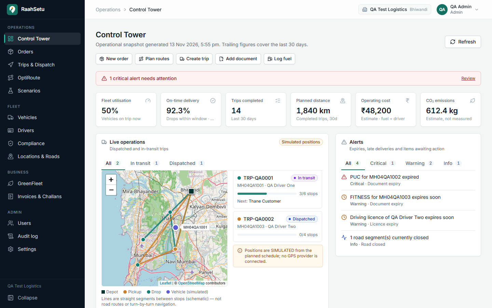

</div>

---

## Contents

1. [The problem](#the-problem) · 2. [The solution](#the-solution) · 3. [Features](#features) · 4. [Screenshots](#screenshots) · 5. [Tech stack](#tech-stack) · 6. [Architecture](#architecture) · 7. [Workflow](#end-to-end-workflow) · 8. [Repository structure](#repository-structure) · 9. [Getting started](#getting-started) · 10. [Configuration](#configuration) · 11. [API overview](#api-overview) · 12. [Roles & permissions](#authentication--authorisation) · 13. [Testing](#testing) · 14. [Production build & deployment](#production-build--deployment) · 15. [Security](#security-considerations) · 16. [Known limitations](#known-limitations) · 17. [Roadmap](#roadmap) · 18. [Contributing](#contributing) · 19. [License](#license)

## The problem

Small and mid-size Indian transport operators juggle vehicles, drivers, RC/insurance/PUC expiries, customer orders and trips across spreadsheets, WhatsApp and phone calls. Routes are planned by gut feel or shortest distance, which ignores what actually constrains a day's work: truck capacity, pickup-before-drop, customer delivery windows, driver shift limits and documents that have quietly expired. Billing and proof of delivery live in yet another system.

## The solution

RaahSetu puts the whole operation into one **multi-tenant web application** and adds an optimiser that answers the dispatcher's real question — *which vehicle should take which orders, in what sequence, today?* — while explaining every trade-off it makes.

- One place for fleet, drivers, compliance documents, locations, orders, trips, invoices and an audit trail.
- **OptiRoute**, a constrained pickup-and-delivery optimiser with an independent validator, so a plan marked feasible really is.
- What-if scenarios (breakdown, absent driver, road closure, urgent order) with before/after comparison and manager approval.
- Location search with autocomplete, map pins and reverse geocoding, using the operator's own LocationIQ key — kept on the server.
- Honest numbers: estimates, simulated vehicle positions and sample data are labelled as such in the UI.

## Features

Everything below is implemented in this repository (see the module column for where).

| Module | What it does | Code |
|---|---|---|
| **Control Tower** | KPIs (fleet utilisation, on-time delivery, trips, distance, cost, CO₂ — last 30 days), critical alerts, live operations with simulated positions, orders awaiting planning, compliance expiries, recent activity, fuel & emissions | `frontend/src/app/(app)/dashboard`, `backend/src/modules/controlTower` |
| **Fleet** | Vehicles (capacity, fuel type, mileage, depot, status), drivers (licence, shift limit, optional link to a driver login) | `vehicles`, `drivers` |
| **Compliance** | RC, insurance, PUC, fitness, permit and licence records with expiry states; private, signature-checked uploads; expired documents exclude vehicles/drivers from planning | `documents` |
| **Locations & roads** | Depots, warehouses and customers on a Leaflet/OpenStreetMap map; editable road graph with one-way/closed segments; shortest path with A* vs Dijkstra comparison | `locations`, `roadNetwork` |
| **Location search** | Address/landmark autocomplete (LocationIQ, server-side key), draggable pin, "Use pin's address" reverse geocoding with a confirm-before-apply preview, Indian state/UT and PIN normalisation, saved-location suggestions and duplicate warnings | `places`, `PlacePicker`, `LocationForm` |
| **Orders** | Pickup/drop, weight, priority, ready time, delivery window, service time; create pickup/drop locations inline | `orders` |
| **OptiRoute** | Multi-vehicle pickup-and-delivery with time windows: greedy insertion → local search → simulated annealing; reasons for every unserved order; objective breakdown; run history and side-by-side comparison | `optimizer`, `optiroute` |
| **Trips & dispatch** | Trips from a plan or created manually; state machine PLANNED → DISPATCHED → IN_TRANSIT → COMPLETED (or CANCELLED); stop-level progress by drivers; timeline; QR | `trips` |
| **Scenarios** | Vehicle breakdown, driver unavailable, road closure, urgent order → re-optimise → compare → approve/reject (managers) | `scenarios` |
| **GreenFleet** | Fuel, cost and CO₂ estimates per vehicle for any job; estimated vs logged fuel; fuel log; every assumption visible and configurable | `greenfleet`, `fuel` |
| **Invoices & challans** | GST invoices and delivery challans (draft → issued → paid / cancelled) with a public QR verification page | `billing`, `verify` |
| **Administration** | Company sign-up, five roles, user management, company settings (fuel prices, emission factors, cost weights, alert days), audit log | `auth`, `users`, `company`, `audit` |

## Screenshots

> Captured from the current production build. The data shown is the built-in **sample dataset** used by the automated browser tests (fictional company "QA Test Logistics"); maps use OpenStreetMap tiles.

| | |
|---|---|
| **Control Tower** — KPIs, alerts, live operations<br> | **Fleet** — vehicles with status, depot and compliance<br>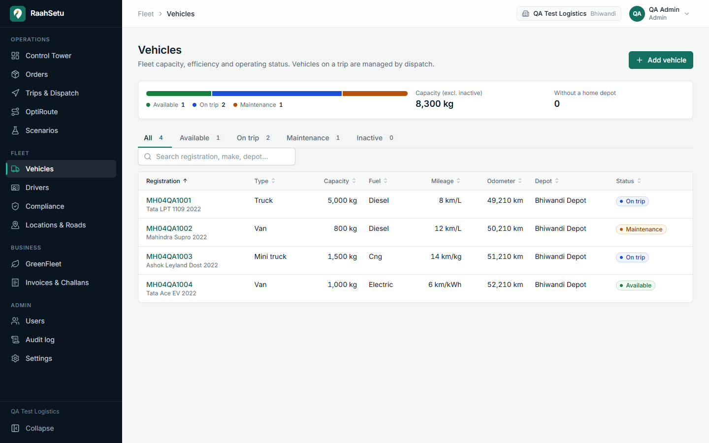 |
| **Orders** — status tabs, priorities, windows<br>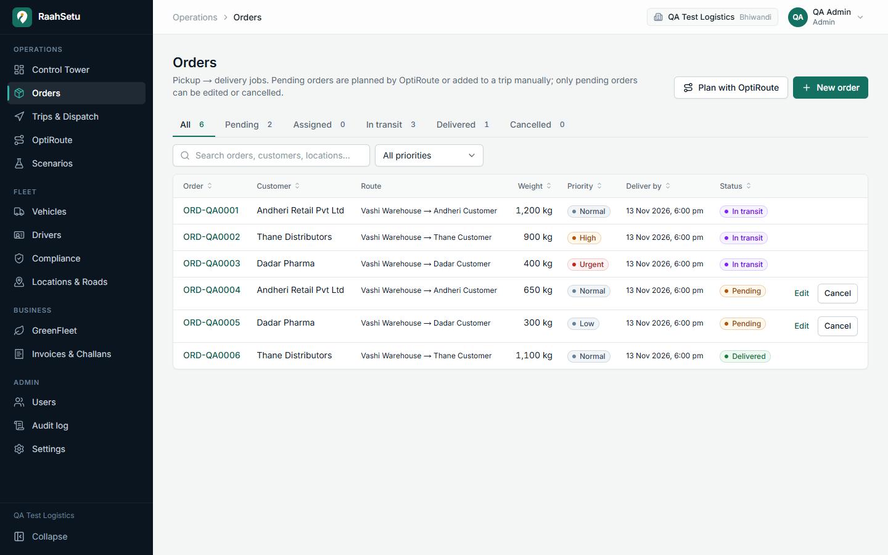 | **Trip detail** — lifecycle, stop timeline, map<br>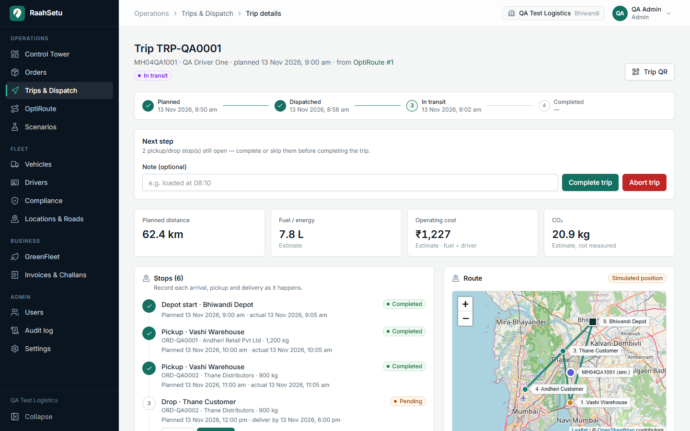 |
| **OptiRoute plan** — routes, unserved reasons, objective<br>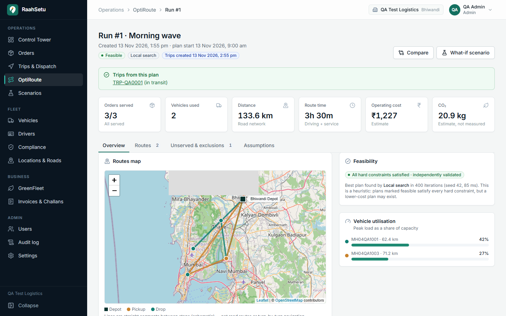 | **Locations & roads** — map, road graph, shortest path<br>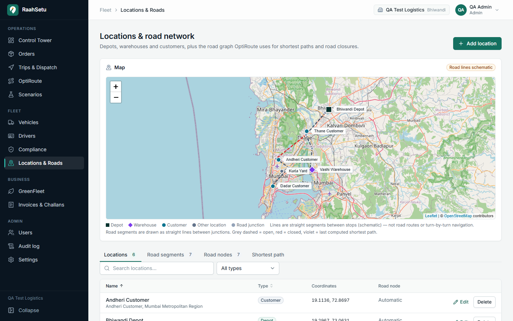 |
| **Location search** — autocomplete, pin, saved locations<br>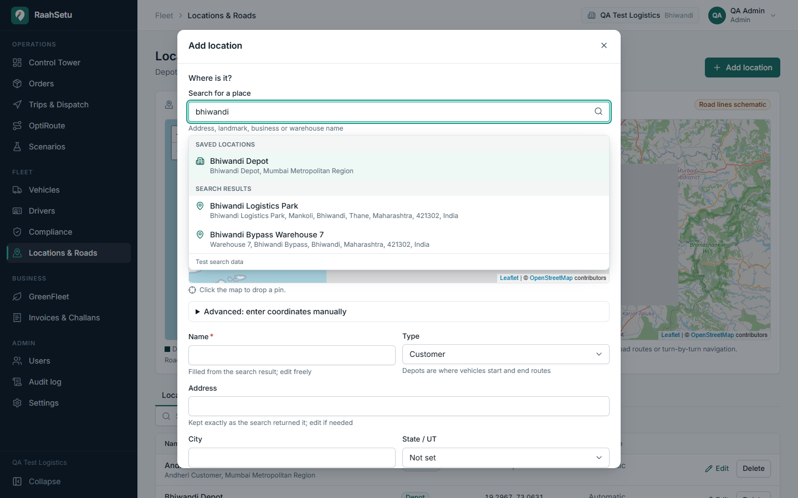 | **Use pin's address** — preview before applying<br>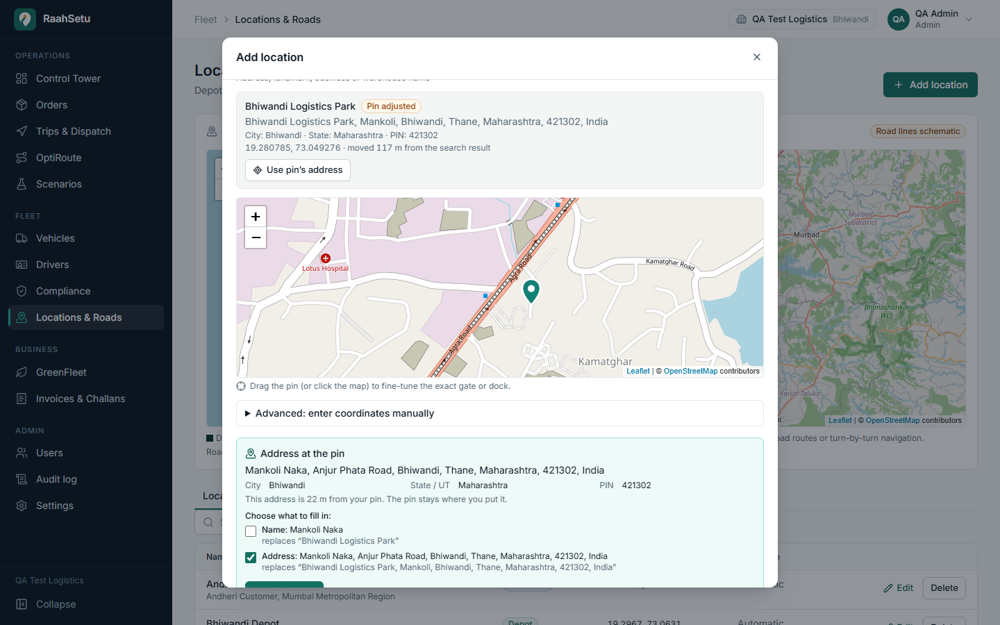 |
| **Compliance** — expiry states and alerts<br>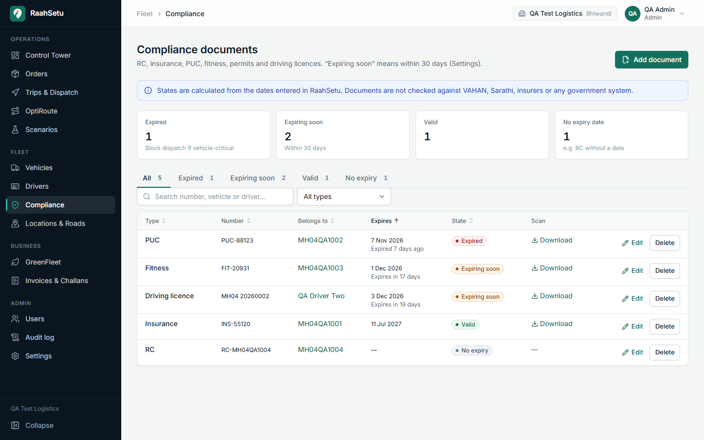 | **Invoice** — GST lines, QR verification<br>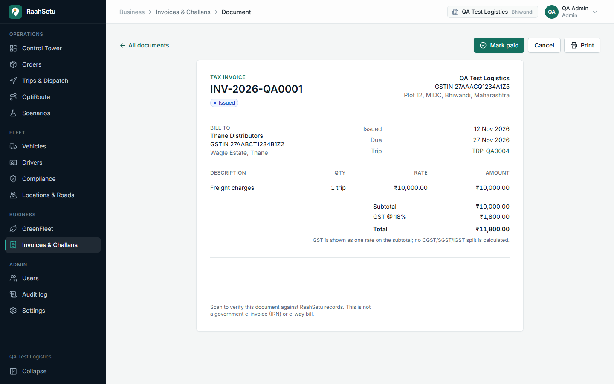 |

## Tech stack

| Layer | Technology |
|---|---|
| Frontend | Next.js 16 (App Router), React 19, TypeScript, Tailwind CSS 4, Leaflet 1.9 + OpenStreetMap tiles, lucide-react icons, an in-house design system (`frontend/src/components/ds`) |
| Backend | Node.js (≥ 20.19; 22 recommended), Express 5, TypeScript, Zod 4, JSON Web Tokens, bcrypt, Helmet, express-rate-limit, Multer, QRCode |
| Database | PostgreSQL 15+ (CI uses 16), Prisma 7 with the `@prisma/adapter-pg` driver adapter, SQL migrations |
| Location search | LocationIQ autocomplete + reverse geocoding (OpenStreetMap data); provider adapter interface with a Geoapify adapter |
| Testing | Vitest, Supertest, real-PostgreSQL integration tests, Playwright browser tests |
| Tooling | ESLint 9, esbuild, GitHub Actions CI, Docker / Docker Compose |

## Architecture

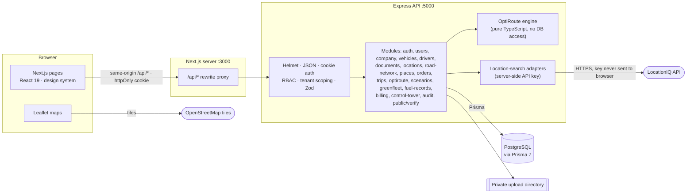

- The browser only talks to the Next.js server; `next.config.ts` rewrites `/api/*` to Express, so the session cookie is first-party and CORS stays closed.
- Each API module validates input with Zod, checks a permission from one role → permission matrix, and scopes every query to the caller's company.
- OptiRoute is a pure function, `solve(instance) → solution`, so it is unit-tested and benchmarked without a database.

Details: [docs/ARCHITECTURE.md](docs/ARCHITECTURE.md).

## End-to-end workflow

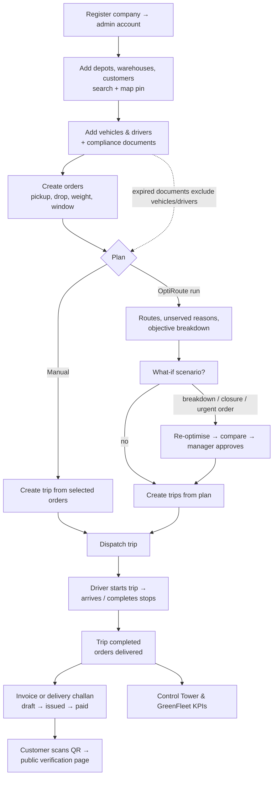

## Repository structure

```
RaahSetu/
├─ package.json            root scripts: setup, dev, build, typecheck, lint, test, db:*
├─ docker-compose.yml      PostgreSQL + API + web for a one-command local demo
├─ .env.example            used only by docker-compose
├─ .github/workflows/ci.yml   type-check, lint, tests on PostgreSQL, builds, benchmark smoke run
├─ docs/                   architecture, installation, API, database, security, testing, deployment, OptiRoute
├─ backend/                Express 5 API
│  ├─ prisma/              schema.prisma · migrations/ (3) · seed.ts (development demo data)
│  ├─ src/
│  │  ├─ app.ts · server.ts
│  │  ├─ config/           env.ts (validated environment) · prisma.ts
│  │  ├─ middleware/       auth.ts (JWT cookie/Bearer, permissions) · error.ts
│  │  ├─ lib/              permissions matrix, audit, errors, validation, tokens, numbering
│  │  ├─ modules/          one folder per API area (routes + services)
│  │  ├─ optimizer/        OptiRoute: graph (Dijkstra/A*), cost model, solver, validator, synthetic instances
│  │  └─ scripts/benchmark.ts
│  └─ tests/               unit/ · integration/ (real PostgreSQL) · globalSetup.ts
└─ frontend/               Next.js 16 web app
   ├─ public/brand/        RaahSetu logo, mark and symbol (SVG)
   ├─ src/app/             landing, login, register, verify/[token], (app)/… 22 signed-in pages
   ├─ src/components/      design system (ds/), app shell, maps, PlacePicker, LocationForm, forms
   ├─ src/lib/             API client, permissions/nav, formatters, billing & validation mirrors, places helpers
   └─ e2e/                 Playwright specs with an in-browser mocked API (fixtures/)
```

## Getting started

Full walkthrough (including Windows/PowerShell notes and troubleshooting): **[docs/INSTALLATION.md](docs/INSTALLATION.md)**.

### Prerequisites

| Tool | Version |
|---|---|
| Node.js | 22 LTS recommended (`.nvmrc`); `>= 20.19` required |
| npm | 10+ |
| PostgreSQL | 15, 16 or 17 |
| Git | any recent version |

### From a fresh clone

```bash
git clone https://github.com/<your-username>/RaahSetu.git
cd RaahSetu

# 1. Install root, backend and frontend dependencies from the lockfiles
npm run setup:ci          # or: npm run setup

# 2. Create a database user and two databases (choose your own password)
psql -U postgres -h localhost -c "CREATE ROLE raahsetu WITH LOGIN PASSWORD 'CHANGE_ME' CREATEDB;"
psql -U postgres -h localhost -c "CREATE DATABASE raahsetu OWNER raahsetu;"
psql -U postgres -h localhost -c "CREATE DATABASE raahsetu_test OWNER raahsetu;"   # used (and wiped) by integration tests only

# 3. Configure environment files (placeholders only in the examples)
cp backend/.env.example backend/.env
cp frontend/.env.example frontend/.env.local
#    edit backend/.env: DATABASE_URL, TEST_DATABASE_URL, JWT_SECRET (see Configuration)

# 4. Create the tables
npm run db:deploy

# 5. (Optional) load development demo data — only on a local, empty database
npm run db:seed

# 6. Start the API (:5000) and the web app (:3000)
npm run dev
```

Open <http://localhost:3000>. With the demo data loaded you can log in as `dispatcher@demo.raahsetu.local` (also `admin@`, `manager@`, `viewer@`, `driver@` on the same domain) with the demo password `Demo@1234`; with `NEXT_PUBLIC_DEMO_MODE=true` the login page shows one-click buttons. Without the demo data, use **Register your company** to create your own admin account. API health: <http://localhost:5000/api/health>.

## Configuration

### Backend — `backend/.env`

| Variable | Required | Purpose |
|---|---|---|
| `DATABASE_URL` | yes | PostgreSQL connection string for the app database |
| `TEST_DATABASE_URL` | for integration tests | A **separate** database; the test setup drops and recreates its `public` schema on every run (it refuses a database literally named `raahsetu`) |
| `JWT_SECRET` | yes | ≥ 32 random characters: `node -e "console.log(require('crypto').randomBytes(48).toString('base64url'))"` |
| `JWT_EXPIRES_IN` | no (`8h`) | Session lifetime |
| `PORT` | no (`5000`) | API port |
| `NODE_ENV` | no | `development` / `test` / `production` |
| `CORS_ORIGIN` | no | Allowed origin(s), comma-separated (`http://localhost:3000`) |
| `PUBLIC_APP_URL` | no | Base URL printed in QR codes |
| `COOKIE_SECURE` | no (`false`) | `true` when served over HTTPS |
| `UPLOAD_DIR`, `MAX_UPLOAD_MB` | no | Private directory and size limit for compliance uploads |
| `AUTH_RATE_LIMIT_PER_15_MIN` | no (`50`) | Login/registration attempts per IP |
| `ALLOW_DEMO_SEED` | no (`false`) | Only for a public demo deployment; lets the seed run with `NODE_ENV=production` |
| `PLACES_PROVIDER` | no (`none`) | `none`, `locationiq` or `geoapify` |
| `PLACES_API_KEY` | with a provider | Your provider key — server-side only |
| `PLACES_FALLBACK_PROVIDER`, `PLACES_FALLBACK_API_KEY` | no | Optional second provider, used only when the first one fails |
| `PLACES_COUNTRY` | no (`in`) | Two-letter country filter for suggestions |
| `PLACES_RATE_LIMIT_PER_MIN` | no (`120`) | Location searches per company per minute |

### Frontend — `frontend/.env.local`

| Variable | Purpose |
|---|---|
| `BACKEND_URL` | Where the Next.js server proxies `/api/*` (default `http://localhost:5000`) |
| `NEXT_PUBLIC_DEMO_MODE` | `true` shows one-click demo logins (only useful with the demo seed) |
| `NEXT_PUBLIC_MAP_TILE_URL` | Tile URL template; `none` disables tiles (schematic map) |
| `NEXT_PUBLIC_MAP_ATTRIBUTION`, `NEXT_PUBLIC_MAP_MAX_ZOOM` | Map attribution (cannot be blank) and max zoom |

`NEXT_PUBLIC_*` values are compiled into browser code, so never put a secret in a frontend variable.

### Location search with your own LocationIQ key

1. Create a free account at <https://locationiq.com> and copy your **access token**.
2. In `backend/.env` set:
   ```env
   PLACES_PROVIDER=locationiq
   PLACES_API_KEY=<your LocationIQ access token>
   ```
3. Restart the backend. Location dialogs now show **Search for a place**; without a key they still work with the map pin and manual coordinates.

The browser only calls RaahSetu's own `/api/places/*` endpoints; the key stays on the server and is never logged. Each pause while typing (≥ 3 characters, 300 ms debounce) is one request, results are cached per dialog, and "Use pin's address" runs only when clicked. Check LocationIQ's current plan limits and terms (commercial use, attribution, storage) before production use.

## API overview

Base URL: `http://localhost:5000/api` (or `http://localhost:3000/api` through the web app's proxy). JSON in, JSON out; errors are `{ "error": { "code", "message", "details" } }`.

| Area | Endpoints |
|---|---|
| Public | `GET /health` · `GET /public/verify/:token` |
| Auth | `POST /auth/register-company` · `POST /auth/login` · `POST /auth/logout` · `GET /auth/me` · `POST /auth/change-password` |
| Company & users | `GET/PATCH /company` · `GET/POST /users` · `PATCH /users/:id` |
| Fleet | `/vehicles` · `/drivers` (CRUD) · `/documents` (CRUD + private file download) |
| Locations | `/locations` (CRUD) · `/road-network` (nodes, edges, `GET /path`) · `/places/status` · `/places/autocomplete` · `/places/reverse` |
| Operations | `/orders` · `/trips` (+ `/status`, `/stops/:stopId`, `/qr`) · `/optiroute/meta`, `/optiroute/runs` (+ `/dispatch`) · `/scenarios` (+ `/approve`, `/reject`) |
| Business | `/billing` (+ `/issue`, `/mark-paid`, `/cancel`, `/qr`) · `/greenfleet/estimate`, `/summary`, `/vehicle/:id` · `/fuel-records` |
| Insight | `GET /control-tower` · `GET /audit` |

Every endpoint with its permission and body: **[docs/API.md](docs/API.md)**.

## Authentication & authorisation

- **Login** returns a JWT that is set as an `httpOnly`, `SameSite=Lax` cookie (`Secure` with `COOKIE_SECURE=true`) and also returned for API clients (`Authorization: Bearer <token>`). Passwords are hashed with bcrypt (cost 12); login timing is equalised for unknown emails; auth endpoints are rate-limited.
- **Tenancy:** every request is scoped to the company of the authenticated user, loaded from the database — never from request input. Other companies' records return 404.
- **Roles** (from `backend/src/lib/permissions.ts`, the single source of truth; the frontend hides pages and actions using the same list from `/auth/me`):

| Permission | Admin | Manager | Dispatcher | Employee (read-only) | Driver |
|---|:-:|:-:|:-:|:-:|:-:|
| Company settings, users | ✅ | | | | |
| Fleet & documents — write | ✅ | ✅ | | | |
| Billing — write, approve scenarios, audit log | ✅ | ✅ | | | |
| Orders, trips, locations — write; run OptiRoute; log fuel | ✅ | ✅ | ✅ | | |
| Progress trips (start, stops, complete) | ✅ | ✅ | ✅ | | own trips |
| Read fleet, orders, plans, billing, GreenFleet, dashboard | ✅ | ✅ | ✅ | ✅ | |
| Read trips and locations | ✅ | ✅ | ✅ | ✅ | ✅ |

## Testing

```bash
npm run typecheck                          # backend + frontend
npm run lint                               # backend + frontend
npm test                                   # backend unit + integration, frontend unit
npm --prefix backend run test:unit         # no database needed
npm --prefix backend run test:integration  # needs TEST_DATABASE_URL (wiped on every run)
npm --prefix frontend run test:e2e         # Playwright browser tests (mocked API; see docs/TESTING.md)
npm run build                              # production builds
npm run check                              # typecheck → lint → test → build
```

What each suite covers and the latest verified results: **[docs/TESTING.md](docs/TESTING.md)**.

## Production build & deployment

```bash
npm run build     # backend → backend/dist/server.js (esbuild) · frontend → .next (Next.js)
npm run db:deploy # apply migrations to the target database
npm start         # API :5000 + web :3000
```

Options covered in **[docs/DEPLOYMENT.md](docs/DEPLOYMENT.md)**: Docker Compose on a single host, or managed PostgreSQL (e.g. Neon) + API host (e.g. Render) + Vercel for the web app, plus a production checklist.

## Security considerations

Summary — full details in **[docs/SECURITY.md](docs/SECURITY.md)**:

- Secrets live only in untracked `.env` files; only `*.env.example` files with placeholders are committed.
- Session cookie is `httpOnly`; the API is same-origin through the Next.js proxy; Helmet headers on the API; `nosniff`, `Referrer-Policy` and `X-Frame-Options: DENY` on the web app.
- Zod validation on every body/query; consistent error format; no stack traces to clients.
- Tenant isolation and role checks on every route, covered by integration tests.
- Uploads: type allow-list, file-signature check, size limit, random storage keys, authenticated download only.
- Third-party API keys (LocationIQ) are used only by the backend; the browser bundle contains no server secrets.
- Rate limits on authentication, public QR verification and location search.

## Known limitations

- **Simulated tracking:** vehicle positions are interpolated from the plan and labelled "simulated"; there is no GPS/telematics integration or notification centre.
- **Billing:** one GST rate on the subtotal (no CGST/SGST/IGST split, IRN or e-way bill); "Mark paid" records status, not payment amounts.
- **Compliance:** expiry states come from entered dates; no VAHAN/Sarathi/insurer verification. A stored scan cannot be replaced on edit (add a new document instead).
- **Audit log:** trip status changes, OptiRoute runs/dispatch and scenario decisions are not yet written to the audit log (trip history is still available on each trip).
- **Scale:** `GET /orders` is not paginated, `GET /trips` returns the latest 200, OptiRoute runs synchronously inside the request (fine for the benchmarked sizes), Control Tower KPIs use a fixed 30-day window.
- **Location search:** OpenStreetMap-based data is good for landmarks, localities and PIN codes but weaker for company/warehouse names; a fallback provider for zero-result searches is not enabled.
- **Maps:** OpenStreetMap's public tile server is for light use — configure another tile provider for production traffic.
- **Accounts:** no email/SMS, password reset or SSO (admins create users; users change passwords in Settings).
- **Storage:** uploads go to a local directory (swap `backend/src/modules/documents/storage.ts` for object storage in the cloud).
- **Hardening:** no Content-Security-Policy header yet; colour-contrast and screen-reader testing still need a manual pass.

## Roadmap

1. Audit events for trips, OptiRoute and scenarios; date-range filters on the Control Tower.
2. Server-side pagination for orders and trips; background jobs for large OptiRoute instances.
3. Email/SMS notifications and password reset.
4. GPS/telematics adapter replacing the simulator (`backend/src/modules/trips/telemetry.ts`).
5. GST e-invoice / e-way bill integration via a GST Suvidha Provider; CGST/SGST/IGST split.
6. Object storage for documents; Content-Security-Policy; mobile-first driver app.

## Contributing

Contributions are welcome — please read **[CONTRIBUTING.md](CONTRIBUTING.md)** (setup, branch and commit conventions, the checks a pull request must pass, and how to report security issues).

## License

[MIT](LICENSE) © 2026 Ayush Mishra
