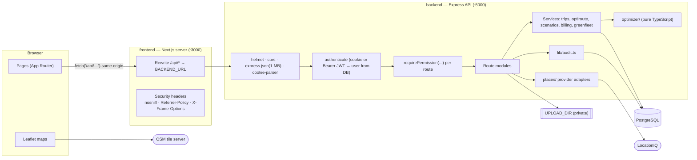
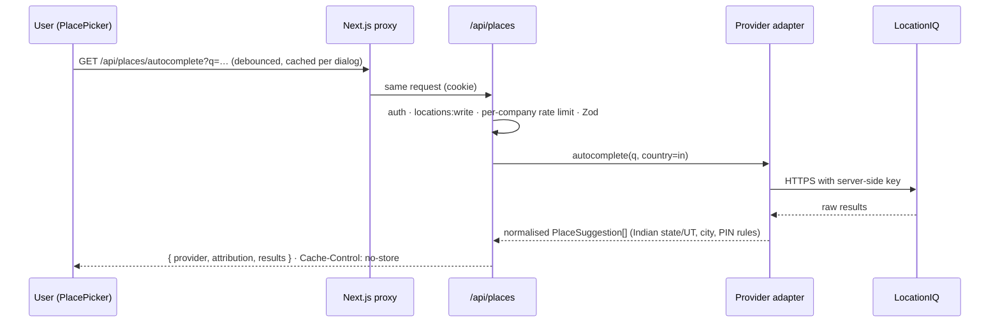

# Architecture

RaahSetu is a two-process web application — a **Next.js 16** frontend and an **Express 5** API — backed by **PostgreSQL** through **Prisma 7**. Both are TypeScript. This document describes how the pieces fit together; every component named here exists in the repository.

## System overview



### Request lifecycle

1. The browser calls `/api/...` on the Next.js origin (`frontend/src/lib/api.ts`, `credentials: "same-origin"`).
2. `frontend/next.config.ts` rewrites the request to `BACKEND_URL` (default `http://localhost:5000`), so the `rs_token` session cookie is first-party.
3. Express (`backend/src/app.ts`) applies Helmet, CORS (closed to other origins), a 1 MB JSON limit and cookie parsing. Public routes are `/api/health`, `/api/auth/*` and `/api/public/verify/*`; everything else goes through `authenticate`.
4. `authenticate` (`backend/src/middleware/auth.ts`) verifies the JWT (HS256), loads the **user from the database** (inactive users are rejected) and sets `req.auth = { userId, companyId, role, email, driverId }`.
5. Each route calls `requirePermission(...)`, which checks the role against the matrix in `backend/src/lib/permissions.ts`.
6. Handlers validate input with Zod (`backend/src/lib/validate.ts`), query Prisma **always with `companyId` from `req.auth`**, and write audit events (`backend/src/lib/audit.ts`) for significant changes.
7. Errors are thrown as `AppError` and rendered by `backend/src/middleware/error.ts` as `{ error: { code, message, details } }`; Prisma unique/foreign-key/serialisation errors map to 409, unknown errors to a generic 500.

## Backend

```
backend/src/
├─ app.ts               Express app factory (also used by integration tests)
├─ server.ts            HTTP server, graceful shutdown, startup log (database name and host, never credentials)
├─ config/env.ts        Zod-validated environment (fails fast on bad config)
├─ config/prisma.ts     Prisma client with the pg driver adapter
├─ middleware/          auth.ts (JWT + permissions), error.ts
├─ lib/                 permissions, audit, errors, http (authOf), validate, tokens (QR tokens), numbering (dated, collision-resistant document numbers)
├─ modules/<area>/      <area>.routes.ts (+ service where logic is non-trivial)
├─ optimizer/           OptiRoute engine (no I/O)
└─ scripts/benchmark.ts reproducible optimiser benchmark
```

| Module | Mounted at | Responsibility |
|---|---|---|
| `auth` | `/api/auth` | Company registration, login/logout (cookie + token), `me` (user, company, permission list), change password; rate-limited |
| `verify` | `/api/public/verify` | Public QR verification of trips, invoices and challans (minimal data, rate-limited) |
| `company` | `/api/company` | Company profile and validated settings (fuel prices, emission factors, cost weights, alert days) |
| `users` | `/api/users` | User management (admin); protects the last admin |
| `vehicles`, `drivers` | `/api/vehicles`, `/api/drivers` | Fleet CRUD; drivers can be linked to a DRIVER login |
| `documents` | `/api/documents` | Compliance documents, expiry states, private file storage (`storage.ts`) |
| `locations` | `/api/locations` | Locations with optional search details (city, state, PIN, provider ids, coordinate source) |
| `roadNetwork` | `/api/road-network` | Road nodes/edges (one-way, closed), shortest path (A* with Dijkstra comparison) |
| `places` | `/api/places` | Location-search proxy: status, autocomplete, reverse geocoding; provider adapters; Indian address rules (`india.ts`) |
| `orders` | `/api/orders` | Orders and their lifecycle (PENDING → ASSIGNED → IN_TRANSIT → DELIVERED / CANCELLED) |
| `trips` | `/api/trips` | Trip creation (`tripFactory.ts`), state machine and stop actions (`trips.service.ts`), simulated telemetry (`telemetry.ts`), QR |
| `optiroute` | `/api/optiroute` | Builds an optimisation instance from the database, runs the solver, stores runs, dispatches plans into trips |
| `scenarios` | `/api/scenarios` | What-if re-optimisation, comparison, approve/reject |
| `greenfleet`, `fuel` | `/api/greenfleet`, `/api/fuel-records` | Fuel/cost/CO₂ estimates, estimated vs logged fuel, fuel log |
| `billing` | `/api/billing` | Invoices and delivery challans, totals, status flow, QR |
| `controlTower` | `/api/control-tower` | Aggregated KPIs, alerts and live operations |
| `audit` | `/api/audit` | Audit log listing (admin, manager) |

### OptiRoute engine (`backend/src/optimizer`)

A pure `solve(instance) → solution` with typed inputs (`types.ts`):

- `graph.ts` — road graph, Dijkstra and A*; `distance.ts` — distance/time matrix from the road network or a labelled straight-line estimate.
- `costModel.ts` — fuel, cost and CO₂ per leg (shared with GreenFleet).
- `solver.ts` — greedy cheapest insertion → best-improvement local search (relocate, exchange) → seeded simulated annealing (`rng.ts`).
- `evaluate.ts` — objective with configurable weights; `validate.ts` — independent re-simulation of every route (capacity, precedence, windows, shift, closed roads). A plan is feasible only with zero violations.
- `synthetic.ts` + `scripts/benchmark.ts` — reproducible benchmark instances.

Model, constraints, objective and benchmark results: [OPTIROUTE.md](OPTIROUTE.md).

### Location search (`backend/src/modules/places`)



- `PlacesProvider` interface with `autocomplete()` and optional `reverse()`; adapters for **LocationIQ** and **Geoapify**; `withFallback()` tries a second provider only when the first fails (not when it finds nothing).
- `india.ts` — canonical list of 28 states and 8 union territories (with aliases such as "Orissa" or "NCT of Delhi"), Delhi results without a `state` field, ward/zone/taluka names rejected as cities, PIN validation.
- Upstream URLs carry the key, so they are never logged or included in error messages; failures map to friendly 502/503/504 responses.
- With `PLACES_PROVIDER=none` the endpoints report "not configured" and the UI falls back to the map pin and manual coordinates.

## Frontend

```
frontend/src/
├─ app/
│  ├─ page.tsx · login/ · register/ · verify/[token]/   public pages
│  ├─ (app)/                                            signed-in area (AppShell)
│  │  dashboard · orders · trips (new, [id]) · optiroute (runs/[id], compare)
│  │  scenarios ([id]) · vehicles ([id]) · drivers ([id]) · documents · locations
│  │  greenfleet · billing ([id]) · users · audit · settings
│  ├─ error.tsx · not-found.tsx · layout.tsx · icon.svg · apple-icon.png · favicon.ico
├─ components/
│  ├─ ds/        design system: Button, FormControls, Feedback, Surfaces (DataTable, ListCard, Tabs…),
│  │             Overlay (Dialog, Drawer), Confirm, Toast, Menu, Charts
│  ├─ shell/     Sidebar, Topbar, Logo, NoAccess
│  ├─ AppShell.tsx · AuthProvider.tsx (session + permissions) · Providers.tsx
│  ├─ RouteMap.tsx · LeafletMap.tsx (routes) · PinMap.tsx (single draggable pin)
│  ├─ PlacePicker.tsx · LocationForm.tsx (location search, reverse geocoding, duplicates)
│  └─ forms.tsx · ComplianceList.tsx
└─ lib/          api client, useApi hook, nav + requiredPermission, format, billing & validation
                 mirrors of backend rules, places & india helpers, map helpers, safe redirects
```

- **Data fetching:** client components call the API through `useApi()`/`api()`; there is no server-side data access in Next.js, so all authorisation lives in Express.
- **Navigation & permissions:** `lib/nav.ts` defines the sidebar and the permission each page needs; `AppShell` renders a "no access" page instead of a page the role cannot use, and actions are hidden by `can(permission)` from `AuthProvider`.
- **Maps:** Leaflet is loaded only on pages that show a map (dynamic import, client-only). Tile URL and attribution are configurable; when tiles fail or are disabled a schematic SVG map is shown.
- **Mirrors of backend rules** (`lib/billing.ts`, `lib/validation.ts`, `orders/validate.ts`, `lib/india.ts`) give instant form feedback; the backend remains authoritative.
- **Responsive design:** tables switch to card lists below 768 px; tested at 390, 768, 1024 and 1440 px.

## Multi-tenancy

- Every tenant-owned table has `companyId`. Handlers never accept `companyId` from the client; they look records up with `{ id, companyId }` and verify that referenced records (locations, vehicles, drivers, orders, trips, road nodes/edges) belong to the same company.
- Cross-company reads, updates, deletes and file downloads return 404. This is covered by the integration tests (`backend/tests/integration/api.test.ts`).

## Consistency and concurrency

- Dispatch, trip transitions, stop updates, scenario approval and billing edits run in database transactions with explicit state checks; write conflicts surface as 409 "please retry".
- Trip status follows a state machine (`PLANNED → DISPATCHED → IN_TRANSIT → COMPLETED`, cancellation from the first three); drivers may only progress their own trips.

## Deployment topology

| Option | Pieces |
|---|---|
| Local development | `npm run dev` → Express on :5000, Next.js dev server on :3000, local PostgreSQL |
| Docker Compose | `postgres:16-alpine` + backend image (migrations on start, optional demo seed) + frontend image (Next.js standalone) |
| Managed services | Managed PostgreSQL (e.g. Neon) + API host (e.g. Render) + Vercel for the web app, which proxies `/api/*` to the API |

See [DEPLOYMENT.md](DEPLOYMENT.md).
