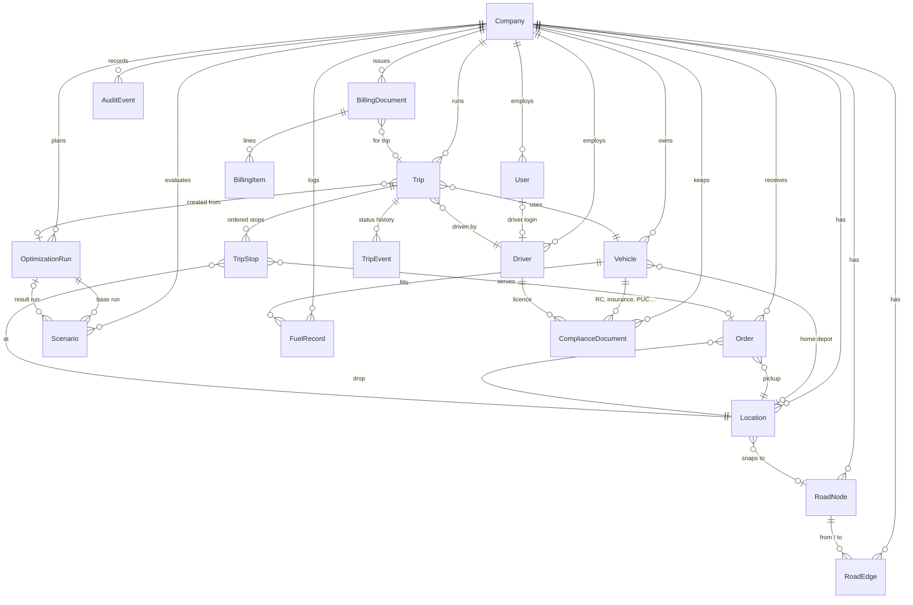

# Database

RaahSetu stores everything in **PostgreSQL** (15+; CI uses 16) through **Prisma 7** with the `@prisma/adapter-pg` driver adapter. The schema lives in [`backend/prisma/schema.prisma`](../backend/prisma/schema.prisma); the generated client is written to `backend/src/generated/prisma` (git-ignored, created by `prisma generate` on install and build).

## Multi-tenancy

Every business table carries a `companyId` foreign key to `Company` with `ON DELETE CASCADE`. The API never takes `companyId` from the client — it comes from the authenticated user — and every lookup is `{ id, companyId }`. Child tables without their own `companyId` (`TripStop`, `TripEvent`, `BillingItem`) are only reached through a tenant-checked parent.

## Entity-relationship diagram



## Models

| Model | Purpose | Key fields & constraints |
|---|---|---|
| `Company` | Tenant | `name`, `gstNumber` (unique, optional), address fields, `settings` (JSON: fuel prices, emission factors, cost weights, alert days — validated by the API) |
| `User` | Login account | `email` (unique), `passwordHash` (bcrypt), `role` (UserRole), `isActive`, `lastLoginAt` |
| `Vehicle` | Fleet vehicle | `registrationNumber` (unique per company), `type`, `capacityKg`, `fuelType`, `mileageKmPerUnit`, `avgSpeedKmph`, `status`, `odometerKm`, optional depot `Location`; `registrationState`, `ownershipType` (OWNED/LEASED/ATTACHED), `ownerName`, `ownerPhone`, `fastagId` |
| `Driver` | Driver profile | `licenseNumber` (unique per company), `licenseExpiry`, `licenseClass`, `licenseIssuedOn`, `status`, `maxShiftHours`, optional link to a DRIVER `User` (unique); KYC (admin/manager only): `address`, emergency contact, `kycIdType`, `kycIdLast4` (never a full ID number), `kycConsentAt`/`kycConsentById`, `kycVerification` |
| `ComplianceDocument` | RC, insurance, PUC, fitness, permits, FASTag, licence, driver photo, KYC proof | `type`, `documentNumber`, `issuedOn`, `expiresOn`, belongs to a vehicle **or** a driver; `verificationStatus` (PENDING/VERIFIED/REJECTED), `verifiedAt`, `verifiedById`, `rejectionReason`; files in `Attachment` (legacy single-file columns kept for older uploads) |
| `Attachment` | A private stored file | `role` (FRONT/BACK/PAGE/PHOTO/SIGNATURE), `fileName`, `fileMimeType`, `fileSizeBytes`, unique random `storageKey`, `sha256`, `uploadedById`; belongs to exactly one of a compliance document, an E-Way Bill or a POD |
| `EwayBill` | E-Way Bill **recorded** by the transporter | `ewbNumber` (unique per company), `documentDate`, `validUntil`, supplier/recipient and GSTINs, places, goods, `hsnCode`, quantity, `taxableValue`, references, `vehicleNumber`, `status` (ACTIVE/CANCELLED); belongs to an `Order`, optional `Trip` |
| `LorryReceipt` | LR / bilty | `lrNumber` (unique per company), booking date, consignor/consignee (+ GSTIN), from/to, goods, packages, weights, `freightAmount`, `paymentTerms`, `status`; belongs to an `Order`, optional `Trip` |
| `ProofOfDelivery` | Delivery record for one DROP stop | unique `tripStopId`, `status` (DELIVERED/PARTIALLY_DELIVERED/FAILED/RETURNED/DISPUTED), receiver, `deliveredAt`, quantity, shortage/damage/remarks, `verificationToken`; signature and photos in `Attachment` |
| `Location` | Depot, warehouse, customer | `name`, `address`, `type`, `lat`, `lng`, optional `roadNode`; location-search details `city`, `state`, `postalCode`, `country`, `placeProvider`, `providerPlaceId`, `coordsSource` (MANUAL/SEARCH/PIN_ADJUSTED, default MANUAL) |
| `RoadNode`, `RoadEdge` | Road graph for routing | edges have `distanceKm`, `speedKmph`, `bidirectional`, `isClosed`, optional `name` |
| `Order` | Transport request | `orderNumber` (unique per company), pickup and drop `Location` (RESTRICT on delete), `weightKg`, `priority`, `readyAt`, `windowStart`/`windowEnd`, `serviceMinutes`, `status`, `declaredValue` |
| `Trip` | Vehicle + driver run | `tripNumber` (unique per company), `status`, planned/actual start and end, planned distance, estimated fuel and cost, optional `OptimizationRun`, unique `verificationToken` for the public QR page |
| `TripStop` | Ordered stop of a trip | `sequence`, `type` (DEPOT_START/PICKUP/DROP/DEPOT_END), `location`, optional `order`, planned/actual arrival, `status` |
| `TripEvent` | Trip status history | `fromStatus`, `toStatus`, `note`, `userId`, timestamp |
| `OptimizationRun` | Stored OptiRoute run | `algorithm`, `seed`, `request` (JSON), `result` (JSON: routes, unserved, violations, objective breakdown), `feasible`, totals, `runtimeMs`, `distanceSource`, `dispatchedAt` |
| `Scenario` | What-if evaluation | `type`, `params` (JSON), `status` (EVALUATED/APPROVED/REJECTED), base and result runs, `comparison` (JSON), decision fields |
| `BillingDocument`, `BillingItem` | Invoice or delivery challan and its lines | `kind`, `number` (unique per company and kind), `status`, customer fields, `taxRatePercent`, `subtotal`/`taxAmount`/`total`, unique `verificationToken`; items with `quantity`, `unit`, `rate`, `amount` |
| `FuelRecord` | Logged fuel/energy purchase | `filledAt`, `quantity`, `totalCost`, `odometerKm` |
| `AuditEvent` | Audit trail | `userId`, `action` (e.g. `order.created`), `entityType`, `entityId`, `metadata` (JSON, never secrets) |

### Enums

| Enum | Values |
|---|---|
| `UserRole` | ADMIN, MANAGER, DISPATCHER, EMPLOYEE (read-only), DRIVER |
| `VehicleType` | TRUCK, MINI_TRUCK, VAN, PICKUP, TRAILER, TANKER |
| `FuelType` | DIESEL, PETROL, CNG, ELECTRIC |
| `VehicleStatus` / `DriverStatus` | AVAILABLE, ON_TRIP, MAINTENANCE / OFF_DUTY, INACTIVE |
| `DocumentType` | RC, INSURANCE, PUC, FITNESS, PERMIT, DRIVING_LICENSE, OTHER |
| `LocationType` | DEPOT, WAREHOUSE, CUSTOMER, OTHER |
| `CoordSource` | MANUAL, SEARCH, PIN_ADJUSTED |
| `OrderPriority` | LOW, NORMAL, HIGH, URGENT |
| `OrderStatus` | PENDING, ASSIGNED, IN_TRANSIT, DELIVERED, CANCELLED |
| `TripStatus` | PLANNED, DISPATCHED, IN_TRANSIT, COMPLETED, CANCELLED |
| `StopType` / `StopStatus` | DEPOT_START, PICKUP, DROP, DEPOT_END / PENDING, ARRIVED, COMPLETED, SKIPPED |
| `OptimizationAlgorithm` | GREEDY_INSERTION, LOCAL_SEARCH, SIMULATED_ANNEALING |
| `ScenarioType` | VEHICLE_BREAKDOWN, ROAD_CLOSURE, URGENT_ORDER, DRIVER_UNAVAILABLE |
| `BillingDocumentKind` / `BillingStatus` | INVOICE, DELIVERY_CHALLAN / DRAFT, ISSUED, PAID, CANCELLED |

### Delete behaviour

- Deleting a `Company` cascades to all of its data.
- Locations used by orders or trip stops cannot be deleted (RESTRICT; the API returns 409 first). Vehicles and drivers with trip history are also protected.
- Deleting a vehicle or driver cascades to its compliance documents; a vehicle's depot or a location's road node is set to `NULL` when removed.

## Migrations

Committed SQL migrations in `backend/prisma/migrations/`, applied in order:

| Migration | Content |
|---|---|
| `20261005105336_init` | Initial schema |
| `20261019120000_raahsetu_v2` | Fleet operations, OptiRoute runs, scenarios, billing, GreenFleet, audit |
| `20261113120000_location_place_details` | Additive: `CoordSource` enum and optional location-search columns on `Location` (`city`, `state`, `postalCode`, `country`, `placeProvider`, `providerPlaceId`, `coordsSource` with default `MANUAL`) |
| `20261118120000_transport_documents_compliance` | Additive: new `DocumentType` values, verification/KYC/ownership columns, HSN and challan fields, and the `Attachment`, `EwayBill`, `LorryReceipt` and `ProofOfDelivery` tables (details in [DOCUMENTS_AND_COMPLIANCE.md](DOCUMENTS_AND_COMPLIANCE.md#10-database-changes)) |

### Commands

| Command | What it does | Safe for existing data? |
|---|---|---|
| `npm run db:deploy` | `prisma migrate deploy` — applies pending committed migrations | ✅ yes (never drops data) |
| `cd backend && npx prisma migrate status` | Lists applied and pending migrations | ✅ read-only |
| `npm --prefix backend run db:generate` | Regenerates the Prisma client | ✅ no database access |
| `npm run db:migrate` | `prisma migrate dev` — creates a **new** migration from schema changes (development only) | ⚠️ may offer to reset a drifted development database |
| `npm run db:seed` | Development demo data (two demo companies, recreated on each run) | ⚠️ replaces the demo companies only; refuses `NODE_ENV=production` unless `ALLOW_DEMO_SEED=true` |
| `npm run db:reset` | `prisma migrate reset --force` | ❌ **deletes all data** |
| `npm --prefix backend run db:studio` | Prisma Studio (browse data) | ✅ (writes only what you edit) |

### Changing the schema

1. Edit `backend/prisma/schema.prisma`.
2. Against a disposable development database, run `npm --prefix backend run db:migrate -- --name <short_description>` to generate and apply a migration.
3. Review the generated SQL — prefer additive changes (new nullable columns, new tables) that keep existing rows valid.
4. Commit the migration folder together with the schema change. Production applies it with `npm run db:deploy`.

### Backups

Before applying migrations to a database with real data, take a backup, for example:

```bash
pg_dump --format=custom --host localhost --port 5432 --username raahsetu --dbname raahsetu --file raahsetu-backup.dump
```

(Pass the connection details as flags: Prisma's `?schema=public` URL parameter is not understood by `pg_dump`.)

Dump files are git-ignored (`*.dump`).

## Test database

`TEST_DATABASE_URL` points to a **separate** database (e.g. `raahsetu_test`). `backend/tests/globalSetup.ts` drops and recreates its `public` schema and replays every migration's SQL before the integration tests run. It refuses to run when `TEST_DATABASE_URL` equals `DATABASE_URL` or when the database is named `raahsetu`.
